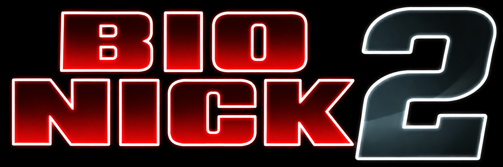

# Bio Nick 2

<p align="center"></p>

Bio Nick 2 is a native Windows port of *Bionic Commando Rearmed 2* (XBLA, "World" release). The game's Xbox 360 code is statically recompiled to x64 Windows code. It runs on a Direct3D 11 renderer with the original game's assets, which you supply yourself.

## Requirements

- Windows 10 or 11, 64-bit, with a Direct3D 11 capable GPU. No Visual C++ redistributable is needed.
- Your own copy of the game file: the XBLA "World" release of Bionic Commando Rearmed 2. It is usually named `52F33688A9A36ABD078C31F43611F166352655B958`, has no extension, and is about 1.41 GB. Its checksums are:

  | Hash | Value |
  |---|---|
  | SHA-256 | `22fdb63f0fef1aa948d15db130868113f59c43bd9fc35515fe74d65613b44fbe` |
  | SHA-1 | `162c25adea84fdc8534808ee0e2560bb0f7f2bcd` |
  | MD5 | `24a9cfc28ff5546e202aa07e40fd3923` |

- An Xbox-style (XInput) controller is optional. Keyboard and mouse are supported.

## First run

Run `bcr2.exe`. If the game has not been unpacked yet, you will be asked to browse for the file above. It is checked against the SHA-256, unpacked into a `game` folder beside the exe (about 1.5 GB), and you are then offered to start the game. The first start compiles the game's shaders, which takes a short while. Later runs go straight to the game, and the original file is no longer needed.

### Files created next to `bcr2.exe`

| Path | Contents |
|---|---|
| `game\` | The unpacked game (`basefile.bin`, `extracted_out\`) |
| `saves\` | Your save data |
| `bcr2.ini` | Settings, written by the in-game menus |
| `shadercache\` | Compiled shaders |
| `screenshots\` | F12 screenshots (PNG) |
| `_debug_logs\`, `_debug_capture\` | Only with `--log` |

Keep `assets\` and `shader_manifest.txt` beside the exe.

## Keys

| Key | Action |
|---|---|
| F12 | Save a screenshot to `screenshots\` |
| F11 or Alt+Enter | Toggle windowed and borderless fullscreen |
| F9 | Only with `--log`: save the last 3 seconds of frames and draw lists to `_debug_capture\f9_<frame>\` |

Keyboard defaults for the actions: Jump `Right Shift`, Extend Arm `Space`, Fire `Numpad 0`, Upgrade `E`, Next/Previous weapon `Page Down` / `Page Up`, Cycle Active upgrade `Delete`, Biovision `Numpad 1`, Cycle Passive upgrade `End`. In menus: arrow keys or W/A/S/D, Enter to confirm, Esc or Backspace to go back. All of these can be rebound under Help & Options > Controls.

## In-game options (Help & Options > Settings)

Graphics Settings (display mode, internal resolution, render resolution, vsync, texture filtering, antialiasing, FPS display, gamma), Controls (press-to-assign pad buttons and keys), button labels (Xbox, PlayStation or Switch), Disable Jump, God Mode, Skip Splash Screens, Swap Confirm & Cancel, and a Music Test. Changes to internal or render resolution need a restart, which the game offers to do. Achievements and Leaderboards are not available in this port and are hidden.

## Command line

```
bcr2.exe [--log]
bcr2.exe --extract <package file> <output folder>
bcr2.exe [--log] <basefile.bin> <game content folder>
```

| Option | Meaning |
|---|---|
| *(no arguments)* | Normal start. Uses the `game` folder next to the exe, running the first-run setup if it is missing. |
| `--log` | Turn on logging. The log is written to `_debug_logs\bcr2_<date>_<time>.log` beside the exe. Also enables shader recording into `shader_manifest.txt` and the F9 capture. Off by default; without it nothing is logged. May be placed anywhere on the command line. |
| `--extract <package> <outdir>` | Unpack the game from the package without starting it. Writes `<outdir>\basefile.bin` and `<outdir>\extracted_out\`. Exit code 0 on success, 1 on failure, 2 for bad usage, 3 if the unpacked program image is not the one this build was made for. |
| `<basefile.bin> <content folder>` | Advanced: start with files in other locations, such as an unpacked game kept elsewhere. |

### `bcr2.ini`

Normally edited through the in-game menus; you can also edit it by hand while the game is closed.

| Key | Values (default first) |
|---|---|
| `display` | `window`, `borderless` (an old `fullscreen` value is treated as `borderless`) |
| `scale` | `auto`, `1`, `2`, `3`, `4` |
| `outres` | `auto`, `720`, `1080`, `1440`, `2160` |
| `vsync` | `on`, `off` |
| `filter` | `default`, `bilinear`, `trilinear`, `aniso2`, `aniso4`, `aniso8`, `aniso16` |
| `aa` | `off`, `fxaa`, `fxaahigh` |
| `fps` | `off`, `on` |
| `gamma` | `100` (50 to 150, percent) |
| `buttons` | `xbox`, `playstation`, `switch` |
| `nojump`, `god`, `skipsplash`, `swapconfirm` | `off`, `on` |
| `b_<action>` | The pad input for an action: `a b x y lb rb lt rt l3 r3` |
| `k_<action>` | The key or mouse button for an action, such as `key_space` or `mouse_left` |

Actions are `jump`, `arm`, `fire`, `upgrade`, `next`, `prev`, `cycleact`, `biovision` and `cyclepas`.

## Known issues

- On the Robot Factory level, boxes on the background conveyor belt sometimes pop in or out. The cause is not found yet.

## AI Disclosure

AI coding tools were used in developing and debugging this port. My focus has been on matching the original game as closely as possible while comparing builds with hardware and emulated references, identifying discrepancies, testing gameplay and prioritizing fixes.

The project uses the original game assets from the player's own Xbox 360 copy. No copyrighted code or copyrighted/trademarked assets are included.
